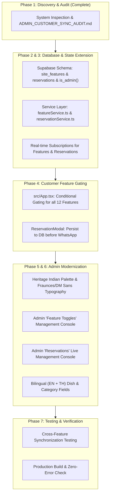

# Namaste Siam Indian Kitchen — Admin Panel & Customer Website Synchronization Audit
**Document ID:** `ADMIN_CUSTOMER_SYNC_AUDIT.md`  
**Date:** November 9, 2026  
**Auditor:** Antigravity System Architect  
**Project Workspace:** `d:\Project\namastesiamindiankitchen`  
**Live Target Reference:** `https://namastesiamindiankitchen.vercel.app/`  

---

## Executive Summary

Namaste Siam Indian Kitchen has reached a high level of frontend polish on its customer-facing website with bilingual capabilities (English & Thai), an interactive menu catalog, WhatsApp ordering drawer, reservation modal, photo gallery with lightbox, and interactive location/Google Maps hub. 

However, a comprehensive architectural audit of both the **Admin Panel** (`/unlock-admin?k=...`) and the **Customer Website** (`/`) reveals significant disconnects between admin operational controls and guest experience. While the database schema (`supabase_schema.sql`) and API layer (`menuService.ts`) support dish, category, restaurant profile, and gallery synchronization with Supabase Realtime, **critical business controls are disconnected or absent**:

1. **No Centralized Feature Toggle System:** The admin panel currently lacks a feature toggle dashboard, and Supabase has no `site_features` table. The customer website renders sections unconditionally without reading global toggle states.
2. **Disconnected Table Reservations:** Guest reservation requests in `ReservationModal.tsx` construct a message and launch WhatsApp/LINE, but **never write to a database**. The admin dashboard has no reservation management view or record log.
3. **Severe Design & Typography Disconnect:** The customer website was upgraded to the **Heritage Indian Design System** (`#173D32` Forest Green, `#D9B66D` Antique Gold, `#F8EEDB` Warm Ivory, `#FFF9EF` Silk Surface, with `Fraunces` serif display and `DM Sans` body fonts). In contrast, the admin panel remains stuck on legacy dark/amber/red hex colors (`#1A0F00`, `#7A5C3E`, `#3D1F00`, `#A90E02`) across 260+ instances, with non-matching generic sans typography.
4. **Missing Thai Input Controls in Admin:** Although the customer site supports English and Thai, dishes and categories in the admin dashboard have no input fields for Thai title or Thai description, forcing reliance on hardcoded dictionary fallbacks.
5. **Security & Schema Discrepancy:** `AdminGate` in `src/App.tsx` requires `supabase.rpc('is_admin')`, but this function is **not defined** in `supabase_schema.sql`. Additionally, `src/components/admin/AdminLoginForm.tsx` is completely orphaned and unreferenced in the codebase.

---

## 1. Project Architecture & Discovery Inventory

### 1.1 Route Mapping
| Interface | Route / URL | Gate & Authentication | Current Behavior |
| :--- | :--- | :--- | :--- |
| **Customer Website** | `/` | Public (Unrestricted) | Displays full guest experience: Hero, Menu, Specials, About, Gallery, Location Hub, Footer. |
| **Admin Gate** | `/unlock-admin?k=<KEY>` | URL param check against `VITE_ADMIN_UNLOCK_KEY` | If `k` matches, displays `AdminGate` sign-in form. If `k` does not match, shows "Access Restricted" or customer view. |
| **Admin Dashboard** | `/unlock-admin?k=<KEY>` | Authenticated Supabase session + `is_admin()` check | Renders `AdminDashboard.tsx` with tabs: Overview, Dishes, Categories, Restaurant, Chat, Gallery. |

### 1.2 Authentication Stack
- **Context:** `src/context/AdminAuthContext.tsx` wraps the entire application in `src/main.tsx`.
- **Active Gate:** `AdminGate` in `src/App.tsx` handles `signInWithPassword`, verifies administrator rights using `supabase.rpc('is_admin')`, and passes data to `AdminDashboard`.
- **Orphaned Component:** `src/components/admin/AdminLoginForm.tsx` contains a legacy login card that is **never imported or rendered** anywhere.

### 1.3 Component & Feature Traceability Matrix

| Feature / Module | Admin Control (`AdminDashboard.tsx`) | Authoritative Store (`Supabase` / `Service`) | Customer Website Implementation (`src/App.tsx`) | Status & Synchronization Health |
| :--- | :--- | :--- | :--- | :--- |
| **Central Feature Toggles** | ❌ **Missing** (No toggles tab or controls) | ❌ **Missing** (No `site_features` table) | ❌ **Hardcoded** (Sections rendered regardless of toggle) | 🔴 **CRITICAL DISCONNECT**: Admin cannot turn features ON/OFF. |
| **Food Menu Catalog** | ✅ Tab: "Cuisine Catalog" (`dishes`) | ✅ `foods` table via `MenuService.saveDish` / `deleteDish` | ✅ `#menu` section with category pills and search | 🟡 **PARTIAL**: Synchronized, but no Thai title/description inputs in admin. |
| **Category Controls** | ✅ Tab: "Categories" (`categories`) | ✅ `categories` table via `MenuService.saveCategories` | ✅ Filter pills in Menu section | 🟡 **PARTIAL**: Synchronized, but no Thai label inputs. |
| **Chef's Specials & Promos** | ✅ Fast Promotion Manager in "Overview" tab | ✅ Dish flags: `chef_special`, `today_special`, `bestseller` | ✅ Chef's Special row & badges in dish cards | 🟢 **SYNCHRONIZED**: Realtime sync updates UI automatically. |
| **WhatsApp Ordering** | ❌ **Missing** (No order audit/tracking view) | ❌ **No order store** | ✅ `OrderDrawer.tsx` & `FloatingCartPill.tsx` | 🟡 **ONE-WAY**: Launches WhatsApp; admin has no dashboard view. |
| **Table Reservation** | ❌ **Missing** (No reservations tab) | ❌ **No reservations table** in `supabase_schema.sql` | ✅ `ReservationModal.tsx` | 🔴 **DISCONNECTED**: Submits to WhatsApp/LINE only; no DB persistence. |
| **Restaurant Gallery** | ✅ Tab: "Ambience Gallery" (`gallery`) | ✅ `gallery` table & Supabase Storage bucket | ✅ `#gallery` grid with `GalleryLightbox.tsx` | 🟢 **SYNCHRONIZED**: Realtime sync via `gallery` postgres channel. |
| **Google Maps & Location** | ✅ Tab: "Restaurant Profile" (`restaurant_info`) | ✅ `restaurant_info` table | ✅ `LocationSection.tsx` with dynamic address embed | 🟢 **SYNCHRONIZED**: Address and hours update dynamically. |
| **WhatsApp & LINE Config**| ✅ Tab: "Chat Integration" (`chat_settings`) | ✅ `chat_settings` table | ✅ Contact buttons, WhatsApp drawer, Reservation modal | 🟢 **SYNCHRONIZED**: Channel toggles (`whatsapp`, `line`, `both`) work. |
| **Language Switcher** | ❌ **No global toggle** (Always enabled) | ❌ Not persisted in DB | ✅ `LanguageContext.tsx` with EN/TH toggle | 🟡 **CLIENT-ONLY**: Saved in `localStorage`; admin cannot disable Thai. |
| **Customer Reviews** | ❌ **Missing** | ❌ **Missing** | ❌ Not currently implemented as a distinct toggleable section | 🔴 **MISSING**: Needs toggleable review component. |
| **Special Offers Banner** | ❌ **Missing** | ❌ **Missing** | ❌ Not currently implemented as a distinct toggleable strip | 🔴 **MISSING**: Needs toggleable offer component. |
| **Group Dining Enquiry** | ❌ **Missing** | ❌ **Missing** | ❌ Handled only within general text | 🔴 **MISSING**: Needs toggleable enquiry option. |
| **Catering Enquiry** | ❌ **Missing** | ❌ **Missing** | ❌ Handled only within general text | 🔴 **MISSING**: Needs toggleable enquiry option. |

---

## 2. In-Depth Gap Analysis

### 2.1 Centralized Feature Control (Phase 2 & 3 Mandate)
- **Problem:** When an admin wants to disable WhatsApp Ordering (e.g., during peak kitchen rush) or disable Table Reservations, there is no UI control and no database table to store the state.
- **Root Cause:** The architecture was built around static section rendering in `App.tsx`.
- **Solution:** 
  1. Create a `site_features` table in Supabase (or fallback persistent config) with single row:
     ```json
     {
       "foodMenu": true,
       "whatsappOrdering": true,
       "tableReservation": true,
       "restaurantGallery": true,
       "googleMaps": true,
       "customerReviews": true,
       "specialOffers": true,
       "chefSpecial": true,
       "groupDining": true,
       "cateringEnquiry": true,
       "englishLanguage": true,
       "thaiLanguage": true
     }
     ```
  2. Add real-time Supabase subscription for `site_features`.
  3. In `src/App.tsx`, conditionally render sections and actions based on these flags:
     - `foodMenu = false` → Displays friendly "Kitchen preparing new seasonal menu" notice or hides `#menu`.
     - `whatsappOrdering = false` → Hides cart pill, order buttons, and ordering drawer.
     - `tableReservation = false` → Hides "Reserve Table" buttons and reservation modal.
     - `restaurantGallery = false` → Hides `#gallery` section.
     - `googleMaps = false` → Hides `#location` section.
     - `customerReviews = false` → Hides reviews section.
     - `specialOffers = false` → Hides special offers banner.
     - `chefSpecial = false` → Hides Chef's Special row.
     - `thaiLanguage = false` → Disables language toggle, locks customer site to English.
  4. Create a new **"Feature Toggles"** management tab in `AdminDashboard.tsx`.

### 2.2 Table Reservation Synchronization
- **Problem:** Currently, when a customer submits a reservation in `ReservationModal.tsx`, it opens `wa.me` or `line.me`. If the user does not send the message, or if staff is away from WhatsApp, the reservation is lost. The admin dashboard has zero visibility into reservations.
- **Solution:**
  1. Create a `reservations` table in Supabase:
     - `id` (UUID), `guest_name`, `guest_phone`, `reservation_date`, `reservation_time`, `party_size`, `seating_area`, `special_requests`, `status` (`pending`, `confirmed`, `cancelled`, `completed`), `created_at`.
  2. Update `ReservationModal.tsx` to insert the reservation record into Supabase *before* redirecting to WhatsApp.
  3. Add a dedicated **"Reservations"** tab in `AdminDashboard.tsx` showing a real-time list of reservation requests, with status change buttons (Confirm, Cancel, Complete).

### 2.3 Visual & Typography Disconnect in Admin Panel
- **Problem:** The admin panel uses old dark/amber/red styling (`#1A0F00`, `#7A5C3E`, `#3D1F00`, `#A90E02`, `#C27318`, `#FDF8F1`). The customer site uses the approved Heritage Indian system (`#173D32` Deep Forest Green, `#D9B66D` Antique Gold, `#F8EEDB` Ivory, `#FFF9EF` Silk Surface).
- **Typography:** Customer headings use serif font `Fraunces` and body uses `DM Sans`. Admin panel uses standard system sans-serif.
- **Solution:** 
  1. Refactor `AdminDashboard.tsx` and `AdminGate` in `App.tsx` to adopt the shared design tokens from `DESIGN.md`.
  2. Apply `font-display` (`Fraunces`) for admin headings, metrics numbers, and modal titles.
  3. Apply `font-body` (`DM Sans`) for labels, table cells, form inputs, and buttons.
  4. Replace legacy red/orange buttons with Deep Forest Green (`#173D32`) primary actions and Antique Gold (`#D9B66D`) badges/highlights.

### 2.4 Bilingual Dish & Category Management
- **Problem:** The types `Dish` and `Category` contain `nameTH?` and `descriptionTH?`, but the admin dish creation form in `AdminDashboard.tsx` (lines 1138–1490) only has fields for English `name` and `description`.
- **Solution:** Add input fields for:
  - Dish Name (Thai)
  - Dish Description (Thai)
  - Category Label (Thai)
  - Ensure `menuService.ts` and `supabase_schema.sql` map and persist these columns.

### 2.5 Security & Integrity Findings
1. **Missing `is_admin()` SQL Function:** `AdminGate` in `src/App.tsx` (line 145) calls `supabase.rpc('is_admin')`. However, `supabase_schema.sql` does not contain `CREATE OR REPLACE FUNCTION is_admin()`. If deployed without it, admin verification fails.
   - *Fix:* Define `is_admin()` in `supabase_schema.sql` checking `auth.jwt() ->> 'email' = 'namastesiamindiankitchen@gmail.com'` or checking an `admin_users` table.
2. **Orphaned Dead Code:** `src/components/admin/AdminLoginForm.tsx` is completely unused.
   - *Fix:* Consolidate the login presentation into `AdminGate` or refactor `AdminGate` to use a styled `AdminLoginForm.tsx`.
3. **Optimistic Toast Notifications:** Some admin actions show success toasts before awaiting the async database mutation, or fail silently if network errors occur.
   - *Fix:* Wrap all admin mutations in `try / catch` blocks with explicit error alerts and confirm successful DB response before showing success toast.

---

## 3. Step-by-Step Implementation Roadmap



### Detailed Execution Breakdown

1. **Step 1: Database Schema Expansion (`supabase_schema.sql`)**
   - Add `site_features` table with 12 toggle booleans, RLS public read, authenticated admin write.
   - Add `reservations` table with RLS public insert, authenticated admin select/update/delete.
   - Add `is_admin()` security definer function returning true for authorized admin accounts.
   - Add `name_th` and `description_th` columns to `foods` and `categories`.

2. **Step 2: Service Layer & Centralized State**
   - Implement `featureService.ts` for reading and updating `site_features`.
   - Implement `reservationService.ts` for guest booking submissions and admin status updates.
   - Add real-time channels for `site_features` and `reservations` in `src/App.tsx`.

3. **Step 3: Customer-Facing Feature Control Enforcement**
   - Wrap all 12 features in `src/App.tsx` with conditional checks:
     - `foodMenu`, `whatsappOrdering`, `tableReservation`, `restaurantGallery`, `googleMaps`, `customerReviews`, `specialOffers`, `chefSpecial`, `groupDining`, `cateringEnquiry`, `englishLanguage`, `thaiLanguage`.
   - Update `ReservationModal.tsx` to save the booking to Supabase before opening WhatsApp.

4. **Step 4: Admin Panel Redesign (Heritage Indian Palette & Typography)**
   - Re-skin `AdminDashboard.tsx` from scratch using `#173D32` (Forest Green), `#D9B66D` (Antique Gold), `#F8EEDB` (Ivory), and `#FFF9EF` (Silk Paper).
   - Adopt `font-display` (`Fraunces`) for all headers and key metrics.
   - Adopt `font-body` (`DM Sans`) for all tables, inputs, labels, and buttons.
   - Re-skin `AdminGate` login view to match the same premium design tokens.

5. **Step 5: Admin Panel Feature Consoles**
   - Add **"Feature Toggles"** console tab in `AdminDashboard.tsx` with live switches for each of the 12 features.
   - Add **"Reservations"** console tab in `AdminDashboard.tsx` with live booking status management.
   - Add Thai input fields to Dish and Category forms.

6. **Step 6: Functional Testing, Build & Final Report**
   - Test toggle OFF/ON persistence and verify instantaneous customer UI response.
   - Test end-to-end reservation booking and admin confirmation.
   - Verify TypeScript compilation and production build (`npm run build`).

---

## 4. Verification Checkpoints for Approval

| Verification Checkpoint | Expected Result |
| :--- | :--- |
| **Feature Toggle: WhatsApp Ordering OFF** | Cart button, dish order buttons, and order drawer disappear immediately from customer site. |
| **Feature Toggle: Table Reservation OFF** | "Reserve Table" buttons in navbar, hero, and footer disappear; modal is inaccessible. |
| **Feature Toggle: Food Menu OFF** | Menu catalog displays an elegant "Menu undergoing seasonal update" heritage banner. |
| **Feature Toggle: Restaurant Gallery OFF** | `#gallery` section is removed from the DOM. |
| **Feature Toggle: Google Maps OFF** | `#location` / Find Us section is cleanly omitted. |
| **Feature Toggle: Thai Language OFF** | Language switch is disabled; site locks to English. |
| **Reservation Submission** | Booking record is saved in Supabase database AND WhatsApp opens with pre-filled message. |
| **Admin Reservation View** | Admin can view booking details and change status (`Pending` -> `Confirmed`). |
| **Admin Visual Consistency** | Admin panel matches `#173D32`, `#D9B66D`, `#F8EEDB`, `Fraunces`, and `DM Sans` seamlessly. |
| **Production Build** | `npm run build` succeeds with 0 errors. |

---

*Phase 1 Audit Complete. No source code modifications have been made pending review and approval.*

